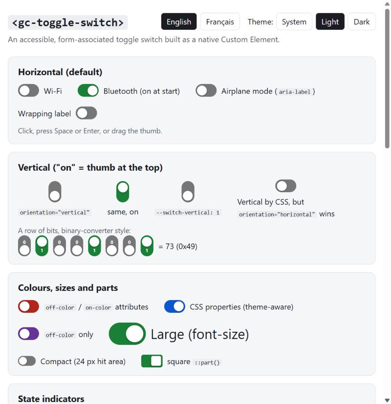

# `<gc-toggle-switch>`

[English](README.md) · **Français**

Interrupteur à bascule réutilisable : un Custom Element natif (le préfixe `gc-` évite les collisions de nom avec d'autres bibliothèques), sans framework ni dépendance, accessible et associé aux formulaires.



**Démonstration en ligne :** <https://slone.github.io/gc-toggle-switch/?lang=fr> (source : [`demo.html`](demo.html), en anglais et en français).

**Dépôt :** <https://github.com/slone/gc-toggle-switch>

## Le nom de ce contrôle

En UX, ce contrôle s'appelle un **toggle switch** (ou simplement **switch**). C'est le terme d'Apple (`UISwitch`, « switch » dans les Human Interface Guidelines), de Material Design et de WAI-ARIA (`role="switch"`). On dit aussi « interrupteur » ou « bouton à bascule » en français.

Ce n'est pas une **case à cocher** (*checkbox*). Les deux portent un état binaire, mais :

- un **switch** dit « allumé / éteint » (*on / off*) et prend effet **immédiatement**, comme un interrupteur électrique (activer le Wi-Fi) ;
- une **case à cocher** dit « coché / non coché » (*checked / unchecked*). Elle sert plutôt à faire un choix qui sera validé plus tard, par exemple à l'envoi d'un formulaire. Elle peut aussi avoir un état intermédiaire (*indeterminate*), ce que le switch n'a pas.

Les lecteurs d'écran annoncent donc « interrupteur, activé » et non « case à cocher, cochée ».

## Installation

Il n'y a rien à compiler. Copiez `gc-toggle-switch.js` dans votre projet et importez-le comme module ES :

```html
<script type="module" src="./gc-toggle-switch.js"></script>
```

ou, depuis un autre module :

```js
import { ToggleSwitch } from './gc-toggle-switch.js';
```

L'élément `<gc-toggle-switch>` est défini automatiquement, une seule fois même si le fichier est importé plusieurs fois.

Le fichier est aussi disponible par CDN via jsDelivr. En production, fixez une version (tag git) :

```html
<script type="module" src="https://cdn.jsdelivr.net/gh/slone/gc-toggle-switch@v1.4.0/gc-toggle-switch.js"></script>
```

> Un module ES ne se charge pas depuis `file://`. Servez la page en HTTP, par exemple avec `python -m http.server` dans ce dossier, puis ouvrez `http://localhost:8000/demo.html`.

## Usage

```html
<label for="wifi">Wi-Fi</label>
<gc-toggle-switch id="wifi" name="wifi" checked></gc-toggle-switch>

<gc-toggle-switch aria-label="Mode avion"></gc-toggle-switch>

<label>Bluetooth <gc-toggle-switch name="bt"></gc-toggle-switch></label>

<gc-toggle-switch orientation="vertical" aria-label="Bit 0"></gc-toggle-switch>

<gc-toggle-switch off-color="#b3261e" on-color="#0b57d0" aria-label="Alarme"></gc-toggle-switch>
```

```js
const sw = document.querySelector('#wifi');
sw.addEventListener('change', () => console.log(sw.checked));
sw.checked = false;   // ne déclenche pas d'événement
sw.toggle();          // idem
```

L'utilisateur peut basculer l'interrupteur en cliquant (ou en touchant) n'importe où dessus, au clavier, ou en **faisant glisser le curseur** comme sur iOS : relâché au-delà de la moitié de la course, l'interrupteur change d'état ; en deçà, il revient à sa position.

## Attributs

| Attribut | Rôle |
|---|---|
| `checked` | État « on ». Il est reflété : la propriété `checked` met l'attribut à jour, et inversement. L'attribut présent dans le HTML (ou posé avec `setAttribute`) définit aussi l'**état par défaut** utilisé par `form.reset()`. |
| `disabled` | Désactive l'interrupteur : il ne bascule plus, sort de l'ordre de tabulation et n'est pas envoyé avec le formulaire. Un `<fieldset disabled>` parent a le même effet. |
| `busy` | Action en cours (par exemple une requête serveur) : un indicateur tourne dans le curseur, `aria-busy="true"` est exposé et les actions de l'utilisateur sont ignorées. L'interrupteur reste focusable. Voir [État occupé](#état-occupé-busy). |
| `required` | Le formulaire n'est pas valide tant que l'interrupteur est sur « off ». Le message est en français si la page (ou un parent) a `lang="fr…"`, en anglais sinon ; il suit les changements de langue. On peut le remplacer avec `setCustomValidity()`. |
| `name` | Nom du champ dans le formulaire. |
| `value` | Valeur envoyée quand l'interrupteur est sur « on » (`on` par défaut). Sur « off », rien n'est envoyé, comme pour une case à cocher. |
| `orientation` | `horizontal` (défaut) ou `vertical`. |
| `off-color` | Couleur de la piste à l'état off (toute couleur CSS valide). |
| `on-color` | Couleur de la piste à l'état on. |
| `state-labels` | Affiche des indicateurs d'état dans la piste : `I` à l'état on, `O` à l'état off (symboles marche/arrêt, comme l'option d'accessibilité d'iOS). Voir [Indicateurs d'état](#indicateurs-détat). |
| `dir` | Hérité de la page ou d'un parent. En `dir="rtl"`, « on » place le curseur à gauche. |
| `aria-label`, `aria-labelledby`, `aria-describedby` | Libellé accessible quand il n'y a pas de `<label>`. |
| `tabindex` | Posé à `0` automatiquement. Une valeur fournie par l'auteur est respectée. |

Les couleurs invalides données en attribut sont ignorées : la couleur passe alors à la propriété CSS, ou à la valeur par défaut.

## Propriétés et méthodes JavaScript

| Membre | Description |
|---|---|
| `checked` | `boolean`, l'état courant (reflété sur l'attribut). |
| `defaultChecked` | `boolean`, l'état restauré par `form.reset()`. |
| `disabled`, `busy`, `required`, `name`, `value`, `orientation` | Reflètent les attributs du même nom. |
| `stateLabels` | `boolean`, reflète l'attribut `state-labels`. |
| `form`, `labels`, `validity`, `validationMessage`, `willValidate` | Comme pour un champ natif. |
| `checkValidity()`, `reportValidity()`, `setCustomValidity(msg)` | Validation, comme pour un champ natif. |
| `toggle(force?)` | Bascule l'état, ou le fixe si `force` est un booléen. Renvoie le nouvel état. |

Comme pour les champs natifs, une modification par script (`checked = …`, `toggle()`) **ne déclenche pas** d'événement.

## Événements

| Événement | Quand |
|---|---|
| `input` | À chaque bascule par l'utilisateur (souris, toucher, glisser, clavier, clic sur le `<label>`). Il remonte le DOM (`bubbles`) et traverse les shadow roots (`composed`). |
| `change` | Juste après `input`. Il remonte le DOM (`bubbles`). |
| `toggle` | Juste après `change`. `CustomEvent` dont `detail` contient `oldChecked` et `newChecked`. Il ne remonte pas le DOM, pour qu'un interrupteur placé dans un `<details>` ne déclenche pas les écouteurs `toggle` de celui-ci : écoutez-le sur l'interrupteur, ou en phase de capture. |
| `click` | Le clavier (Espace, Entrée) et la fin d'un glisser qui change l'état passent aussi par un `click`, comme pour un bouton natif. Annulable, voir ci-dessous. |

```js
sw.addEventListener('toggle', ({ detail }) => {
  console.log(detail.oldChecked, '→', detail.newChecked);
});
```

### Annuler une bascule

Comme avec `<input type="checkbox">`, appeler `event.preventDefault()` dans un écouteur `click` annule la bascule. L'interrupteur revient à son état précédent et aucun des événements `input`, `change` et `toggle` n'est émis. Pendant l'écouteur, `checked` vaut déjà le **nouvel** état, comme pour une case native.

```js
sw.addEventListener('click', (event) => {
  if (!sw.checked && !confirm('Désactiver la sauvegarde automatique ?')) {
    event.preventDefault();
  }
});
```

Les événements `input`, `change` et `toggle` partent une fois le `click` entièrement propagé.

## État occupé (`busy`)

Pour un interrupteur relié à une action asynchrone, posez `busy` pendant l'attente : l'utilisateur voit que l'action est en cours et ne peut pas rebasculer. En cas d'échec, remettez l'état précédent (sans événement) :

```js
sw.addEventListener('change', async () => {
  sw.busy = true;
  try {
    await fetch('/api/wifi', { method: 'PUT', body: String(sw.checked) });
  } catch {
    sw.checked = !sw.checked; // retour à l'état précédent
  } finally {
    sw.busy = false;
  }
});
```

## Orientation : attribut ou CSS

Deux façons de passer en vertical :

```html
<gc-toggle-switch orientation="vertical"></gc-toggle-switch>
```

```css
.colonne-de-bits gc-toggle-switch { --switch-vertical: 1; }   /* 0 = horizontal, 1 = vertical */
```

**L'attribut l'emporte toujours** sur la propriété CSS. On peut donc fixer une orientation par défaut en CSS, pour toute une zone ou selon une media query, puis la changer pour un seul élément avec `orientation="horizontal"` ou `orientation="vertical"`.

`--switch-vertical` doit valoir exactement `0` ou `1`, car c'est un nombre utilisé dans des `calc()`. C'est ce qui permet à la bascule de fonctionner partout, sans *container style queries*.

En vertical, **« on » = curseur en haut**, et la couleur « on » colore la piste.

Sur écran tactile, l'interrupteur laisse la page défiler dans l'axe perpendiculaire au sien et capte le glisser dans son axe. Avec l'attribut `orientation="vertical"`, c'est automatique ; avec `--switch-vertical: 1` seul, ajoutez `touch-action: pan-x pinch-zoom` sur l'élément pour pouvoir le faire glisser au doigt.

## Propriétés CSS personnalisées

| Propriété | Défaut | Rôle |
|---|---|---|
| `--switch-off-color` | `#767676` (clair) / `#8e8e93` (sombre) | Piste à l'état off |
| `--switch-on-color` | `#1a7f37` (clair) / `#2ea043` (sombre) | Piste à l'état on |
| `--switch-thumb-color` | `#ffffff` | Curseur |
| `--switch-thumb-shadow` | ombre légère | Ombre du curseur (`none` pour la retirer) |
| `--switch-thumb-size` | `1.25em` | Diamètre du curseur |
| `--switch-padding` | `0.1875em` | Marge entre le curseur et le bord de la piste |
| `--switch-length` | `1.65 ×` la largeur | Longueur de la piste (grand côté) |
| `--switch-focus-color` | `#0b57d0` / `#a8c7fa` | Anneau de focus |
| `--switch-label-color` | `#ffffff` | Indicateurs d'état (I / O ou contenu des slots) |
| `--switch-halo-color` | gris translucide | Halo autour du curseur au survol et à l'appui (`transparent` pour le retirer) |
| `--switch-duration` | `180ms` | Durée de l'animation |
| `--switch-vertical` | `0` | Orientation (voir plus haut) |

Les tailles sont en `em` : l'interrupteur suit la taille de police de son parent (`font-size: 1.5rem` le grossit). Quelle que soit sa taille, la **zone cliquable fait au moins 24 × 24 px** (critère WCAG 2.5.8) : une marge invisible l'agrandit si besoin.

**Priorité des couleurs :** attribut `off-color` / `on-color` > propriété CSS > défaut.

```css
.marque gc-toggle-switch {
  --switch-off-color: light-dark(#b3261e, #f2b8b5);
  --switch-on-color: light-dark(#0b57d0, #a8c7fa);
  --switch-thumb-color: light-dark(#fff, #1f2229);
}
```

## Parts (`::part()`)

| Part | Élément |
|---|---|
| `track` | La piste (le fond arrondi). |
| `thumb` | Le curseur rond. |
| `on-label` | L'indicateur visible à l'état on. |
| `off-label` | L'indicateur visible à l'état off. |

```css
gc-toggle-switch.carre::part(track) { border-radius: .3em; }
gc-toggle-switch.carre::part(thumb) { border-radius: .2em; }
```

Pour styler selon l'état, on peut utiliser l'attribut reflété, `gc-toggle-switch[checked]::part(thumb)`, ou l'état personnalisé `gc-toggle-switch:state(checked)` dans les navigateurs qui le prennent en charge.

## Indicateurs d'état

Par défaut, l'état se lit à la position du curseur et à la couleur. Pour qu'il se lise aussi **sans la couleur**, ce qui aide les personnes daltoniennes ou malvoyantes, ajoutez `state-labels` :

```html
<gc-toggle-switch state-labels aria-label="Wi-Fi"></gc-toggle-switch>
```

L'indicateur occupe l'extrémité de la piste laissée libre par le curseur : `I` quand l'interrupteur est sur on, `O` quand il est sur off.

Vous pouvez aussi mettre votre propre contenu (texte court, icône) avec les slots `on` et `off`. Les indicateurs s'affichent alors automatiquement :

```html
<gc-toggle-switch orientation="vertical" aria-label="Bit 0">
  <span slot="on">1</span><span slot="off">0</span>
</gc-toggle-switch>
```

Le contenu est affiché à 60 % de la taille du texte et en gras. Il est masqué aux technologies d'assistance : le libellé accessible reste celui du `<label>` ou de l'`aria-label`. Pour un texte plus long que deux caractères (`ON` / `OFF`), allongez la piste avec `--switch-length`.

## Avant le chargement du script

Tant que le module n'est pas chargé, l'élément est inconnu du navigateur : il ne prend aucune place, puis la mise en page saute à l'arrivée du composant. Pour réserver la place dès le premier affichage, copiez cette règle dans la feuille de style de la page :

```css
gc-toggle-switch:not(:defined) {
  --_v0: var(--switch-vertical, 0);
  --_s0: calc(var(--switch-thumb-size, 1.25em) + 2 * var(--switch-padding, 0.1875em));
  --_t0: calc(var(--switch-length, calc(var(--_s0) * 1.65)) - var(--_s0));
  display: inline-block;
  vertical-align: middle;
  width: calc(var(--_s0) + var(--_t0) * (1 - var(--_v0)));
  height: calc(var(--_s0) + var(--_t0) * var(--_v0));
  border-radius: calc(var(--_s0) / 2);
  background: var(--switch-off-color, #767676);
  opacity: 0.5;
}
gc-toggle-switch[orientation="vertical" i]:not(:defined) { --_v0: 1; }
gc-toggle-switch[orientation="horizontal" i]:not(:defined) { --_v0: 0; }
gc-toggle-switch:not(:defined) > * { display: none; }
```

Elle reprend les mêmes propriétés CSS que le composant : la place réservée a exactement la taille finale, quelle que soit l'orientation. Les contenus de slots sont masqués jusqu'au chargement.

## Accessibilité

- **Rôle et état** : `role="switch"` et `aria-checked` sont exposés via `ElementInternals`, sans attributs ajoutés au DOM. `aria-disabled`, `aria-required` et `aria-busy` suivent l'état.
- **Libellé** : `<label for="id">` ou `<label>` englobant (grâce à `formAssociated`, cliquer sur le libellé bascule l'interrupteur), sinon `aria-label` / `aria-labelledby`.
- **Clavier** : l'interrupteur est focusable avec Tab. **Espace** le bascule au relâchement de la touche, comme un bouton natif, sans faire défiler la page. **Entrée** le bascule aussi et n'envoie pas le formulaire.
- **Focus visible** : un anneau autour de la piste, seulement en navigation clavier (`:focus-visible`).
- **Retour visuel** : un halo entoure le curseur au survol (sur les appareils à pointeur) et s'agrandit pendant l'appui, à la souris comme au clavier.
- **Zone cliquable** : au moins 24 × 24 px, même pour un petit interrupteur (critère WCAG 2.5.8).
- **Sans dépendre de la couleur** : l'attribut `state-labels` ou les slots `on` / `off` affichent l'état en clair (critère WCAG 1.4.1).
- **Droite à gauche** : le sens suit `dir` (`:dir(rtl)`). « On » est toujours en fin de ligne, et le glisser suit ce sens.
- **Mouvement réduit** : avec `prefers-reduced-motion: reduce`, il n'y a plus de transition et l'indicateur `busy` tourne lentement.
- **Thèmes clair et sombre** : les couleurs par défaut utilisent `light-dark()` et suivent le `color-scheme` de la page. Déclarez `:root { color-scheme: light dark; }` pour suivre `prefers-color-scheme`, ou `color-scheme: dark` pour forcer le sombre. Dans les navigateurs sans `light-dark()`, une media query `prefers-color-scheme` prend le relais. Contrastes des couleurs par défaut :
  - thème clair : piste off 4,5:1, piste on 5,1:1, contre le curseur blanc comme contre un fond blanc ;
  - thème sombre : piste off et piste on > 5:1 contre le fond, ≥ 3,2:1 contre le curseur.

  Tout cela respecte le seuil WCAG de 3:1 pour les composants d'interface (critère 1.4.11).
- **Contraste élevé** (Windows, `forced-colors`) : la piste et le curseur utilisent les couleurs système (`Canvas`, `CanvasText`, `Highlight`), pour que l'état reste lisible.
- **Désactivé** : l'interrupteur devient semi-transparent, avec le curseur `not-allowed`.

Si vous personnalisez les couleurs, vérifiez le contraste entre la piste et le curseur, et entre la piste et le fond de la page.

## Formulaires

L'élément est un *form-associated custom element* :

- il est envoyé avec le formulaire (`name=value` quand il est sur « on », rien sur « off ») ;
- `required` bloque l'envoi tant qu'il est sur « off » ;
- `form.reset()` lui rend son état par défaut (l'attribut `checked` d'origine, ou `defaultChecked`) ;
- `<fieldset disabled>` le désactive ;
- l'état est restauré par le navigateur lors d'un retour arrière dans l'historique.

## TypeScript et éditeurs

- **TypeScript** : `gc-toggle-switch.d.ts`, placé à côté du module, est pris en compte à l'import. `document.querySelector('gc-toggle-switch')` est alors typé `ToggleSwitch | null`.
- **Custom Elements Manifest** : `custom-elements.json` décrit les attributs, propriétés, événements, slots, parts et propriétés CSS pour les outils qui le lisent (Storybook, générateurs de documentation, certains éditeurs).
- **VS Code** : il ne lit pas ce manifeste de lui-même. Pour compléter la balise et ses attributs en HTML, copiez `vscode.html-custom-data.json` dans votre projet et déclarez-le dans `.vscode/settings.json` :

```json
{ "html.customData": ["./vscode.html-custom-data.json"] }
```

## Compatibilité

Le composant utilise des navigateurs récents : Custom Elements, Shadow DOM, `ElementInternals` avec réflexion ARIA, `adoptedStyleSheets`, `light-dark()`, `:dir()`, Pointer Events. Il fonctionne dans Chrome/Edge, Firefox et Safari dans leurs versions actuelles (2024 et après).

## Fichiers

- `gc-toggle-switch.js` : le composant (module ES, autonome). C'est le seul fichier à copier dans un projet.
- `demo.html` : démonstration de toutes les variantes, en anglais et en français (sélecteur de langue, ou `?lang=fr` / `?lang=en` dans l'adresse).
- `index.html` : redirige vers la démo (pratique pour GitHub Pages).
- `gc-toggle-switch.d.ts`, `custom-elements.json`, `vscode.html-custom-data.json` : types et métadonnées pour les éditeurs (facultatifs).
- `docs/preview.jpg` : capture utilisée dans les README.
- `README.md` (anglais), `README.fr.md` (ce document), `CHANGELOG.md`.
- `package.json` : métadonnées (module ES, licence). Il est marqué `"private": true` pour éviter une publication npm accidentelle. Le nom `gc-toggle-switch` était libre sur npm au 24/11/2026 ; retirez `"private"` pour publier.

## Développement

Aucune étape de build. Pour lancer la démo en local :

```sh
python -m http.server 8000
# ou : npx http-server -p 8000
```

puis ouvrez <http://localhost:8000/demo.html>.

Pour publier la démo avec GitHub Pages : *Settings → Pages → Deploy from a branch*, branche `main`, dossier `/ (root)`.

## Licence

[MIT](LICENSE) © 2026 Chantraine.net
