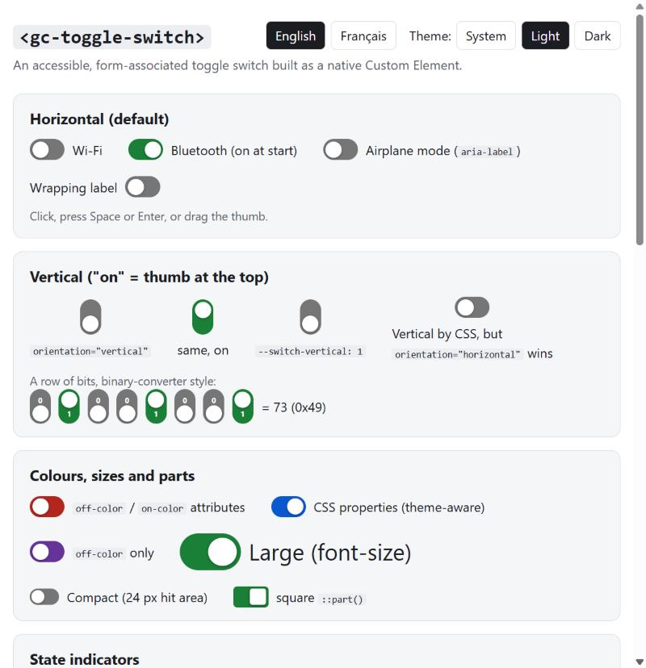

# `<gc-toggle-switch>`

**English** · [Français](README.fr.md)

A reusable toggle switch: a native Custom Element (the `gc-` prefix avoids name clashes with other libraries), with no framework or dependency, accessible and form-associated.



**Live demo:** <https://slone.github.io/gc-toggle-switch/> (source: [`demo.html`](demo.html), in English and French).

**Repository:** <https://github.com/slone/gc-toggle-switch>

## What this control is called

In UX, this control is a **toggle switch** (or just **switch**). That is the term used by Apple (`UISwitch`, "switch" in the Human Interface Guidelines), Material Design and WAI-ARIA (`role="switch"`).

It is not a **checkbox**. Both hold a binary state, but:

- a **switch** says "on / off" and takes effect **immediately**, like a light switch (turning Wi-Fi on);
- a **checkbox** says "checked / unchecked". It is meant for a choice confirmed later, for example when a form is submitted. It can also be in a mixed (*indeterminate*) state, which a switch cannot.

Screen readers therefore announce "switch, on" rather than "checkbox, checked".

## Installation

With npm and a bundler:

```sh
npm install gc-toggle-switch
```

```js
import 'gc-toggle-switch';
```

Without a bundler, there is nothing to build. Copy `gc-toggle-switch.js` into your project and import it as an ES module:

```html
<script type="module" src="./gc-toggle-switch.js"></script>
```

or, from another module:

```js
import { ToggleSwitch } from './gc-toggle-switch.js';
```

The `<gc-toggle-switch>` element is defined automatically, only once even if the file is imported several times.

The file is also available from the jsDelivr CDN. Pin a version (git tag) in production:

```html
<script type="module" src="https://cdn.jsdelivr.net/gh/slone/gc-toggle-switch@v1.4.1/gc-toggle-switch.js"></script>
```

> ES modules do not load from `file://`. Serve the page over HTTP, for example with `python -m http.server` in this folder, then open `http://localhost:8000/demo.html`.

## Usage

```html
<label for="wifi">Wi-Fi</label>
<gc-toggle-switch id="wifi" name="wifi" checked></gc-toggle-switch>

<gc-toggle-switch aria-label="Airplane mode"></gc-toggle-switch>

<label>Bluetooth <gc-toggle-switch name="bt"></gc-toggle-switch></label>

<gc-toggle-switch orientation="vertical" aria-label="Bit 0"></gc-toggle-switch>

<gc-toggle-switch off-color="#b3261e" on-color="#0b57d0" aria-label="Alarm"></gc-toggle-switch>
```

```js
const sw = document.querySelector('#wifi');
sw.addEventListener('change', () => console.log(sw.checked));
sw.checked = false;   // fires no event
sw.toggle();          // neither does this
```

Users can toggle the switch by clicking (or tapping) anywhere on it, with the keyboard, or by **dragging the thumb** as on iOS: released past half of its travel, the switch changes state; otherwise it snaps back.

## Attributes

| Attribute | Purpose |
|---|---|
| `checked` | The "on" state. It is reflected: the `checked` property updates the attribute, and vice versa. The attribute present in the HTML (or set with `setAttribute`) also sets the **default state** used by `form.reset()`. |
| `disabled` | Disables the switch: it no longer toggles, leaves the tab order and is not submitted with the form. A parent `<fieldset disabled>` has the same effect. |
| `busy` | An action is in progress (a server request, for example): a spinner turns in the thumb, `aria-busy="true"` is exposed and user actions are ignored. The switch stays focusable. See [Busy state](#busy-state). |
| `required` | The form is invalid while the switch is off. The message is in French when the page (or a parent) has `lang="fr…"`, in English otherwise, and follows language changes. Override it with `setCustomValidity()`. |
| `name` | Field name in the form. |
| `value` | Value submitted when the switch is on (`on` by default). Nothing is submitted when it is off, as with a checkbox. |
| `orientation` | `horizontal` (default) or `vertical`. |
| `off-color` | Track colour when off (any valid CSS colour). |
| `on-color` | Track colour when on. |
| `state-labels` | Shows state indicators in the track: `I` when on, `O` when off (the power symbols, like iOS's accessibility option). See [State indicators](#state-indicators). |
| `dir` | Inherited from the page or a parent. With `dir="rtl"`, "on" moves the thumb to the left. |
| `aria-label`, `aria-labelledby`, `aria-describedby` | Accessible name when there is no `<label>`. |
| `tabindex` | Set to `0` automatically. A value provided by the author is kept. |

Invalid colours given as attributes are ignored: the colour then falls back to the CSS property, or to the default.

## JavaScript properties and methods

| Member | Description |
|---|---|
| `checked` | `boolean`, the current state (reflected to the attribute). |
| `defaultChecked` | `boolean`, the state restored by `form.reset()`. |
| `disabled`, `busy`, `required`, `name`, `value`, `orientation` | Reflect the attributes of the same name. |
| `stateLabels` | `boolean`, reflects the `state-labels` attribute. |
| `form`, `labels`, `validity`, `validationMessage`, `willValidate` | As for a native field. |
| `checkValidity()`, `reportValidity()`, `setCustomValidity(msg)` | Validation, as for a native field. |
| `toggle(force?)` | Toggles the state, or sets it when `force` is a boolean. Returns the new state. |

As with native fields, a change made by script (`checked = …`, `toggle()`) **fires no event**.

## Events

| Event | When |
|---|---|
| `input` | Each time the user toggles the switch (mouse, touch, drag, keyboard, click on the `<label>`). It bubbles and crosses shadow roots (`composed`). |
| `change` | Right after `input`. It bubbles. |
| `toggle` | Right after `change`. A `CustomEvent` whose `detail` holds `oldChecked` and `newChecked`. It does not bubble, so that a switch inside a `<details>` does not trigger that element's own `toggle` listeners: listen on the switch itself, or in the capture phase. |
| `click` | The keyboard (Space, Enter) and the end of a drag that changes the state also go through a `click`, as with a native button. Cancelable, see below. |

```js
sw.addEventListener('toggle', ({ detail }) => {
  console.log(detail.oldChecked, '→', detail.newChecked);
});
```

### Cancelling a toggle

As with `<input type="checkbox">`, calling `event.preventDefault()` in a `click` listener cancels the toggle. The switch returns to its previous state and none of `input`, `change` and `toggle` is fired. Inside the listener, `checked` already holds the **new** state, as with a native checkbox.

```js
sw.addEventListener('click', (event) => {
  if (!sw.checked && !confirm('Turn off auto-save?')) {
    event.preventDefault();
  }
});
```

`input`, `change` and `toggle` are fired once the `click` has fully propagated.

## Busy state

For a switch tied to an asynchronous action, set `busy` while waiting: users see that the action is in progress and cannot toggle again. On failure, restore the previous state (no event is fired):

```js
sw.addEventListener('change', async () => {
  sw.busy = true;
  try {
    await fetch('/api/wifi', { method: 'PUT', body: String(sw.checked) });
  } catch {
    sw.checked = !sw.checked; // back to the previous state
  } finally {
    sw.busy = false;
  }
});
```

## Orientation: attribute or CSS

Two ways to make the switch vertical:

```html
<gc-toggle-switch orientation="vertical"></gc-toggle-switch>
```

```css
.bit-column gc-toggle-switch { --switch-vertical: 1; }   /* 0 = horizontal, 1 = vertical */
```

**The attribute always wins** over the CSS property. You can set a default orientation in CSS, for a whole area or in a media query, then change it for a single element with `orientation="horizontal"` or `orientation="vertical"`.

`--switch-vertical` must be exactly `0` or `1`, because it is a number used in `calc()`. That is what makes the switch work everywhere, without container style queries.

When vertical, **"on" = thumb at the top**, and the "on" colour fills the track.

On touch screens, the switch lets the page scroll across its axis and captures drags along it. This is automatic with the `orientation="vertical"` attribute; with `--switch-vertical: 1` alone, add `touch-action: pan-x pinch-zoom` to the element so it can be dragged with a finger.

## CSS custom properties

| Property | Default | Purpose |
|---|---|---|
| `--switch-off-color` | `#767676` (light) / `#8e8e93` (dark) | Track when off |
| `--switch-on-color` | `#1a7f37` (light) / `#2ea043` (dark) | Track when on |
| `--switch-thumb-color` | `#ffffff` | Thumb |
| `--switch-thumb-shadow` | subtle shadow | Thumb shadow (`none` to remove it) |
| `--switch-thumb-size` | `1.25em` | Thumb diameter |
| `--switch-padding` | `0.1875em` | Gap between the thumb and the track edge |
| `--switch-length` | `1.65 ×` the width | Track length (long side) |
| `--switch-focus-color` | `#0b57d0` / `#a8c7fa` | Focus ring |
| `--switch-label-color` | `#ffffff` | State indicators (I / O or slot content) |
| `--switch-halo-color` | translucent grey | Halo around the thumb on hover and press (`transparent` to remove it) |
| `--switch-duration` | `180ms` | Animation duration |
| `--switch-vertical` | `0` | Orientation (see above) |

Sizes are in `em`: the switch follows its parent's font size (`font-size: 1.5rem` makes it bigger). Whatever its size, the **hit area is at least 24 × 24 px** (WCAG 2.5.8): an invisible margin extends it when needed.

**Colour priority:** `off-color` / `on-color` attribute > CSS property > default.

```css
.brand gc-toggle-switch {
  --switch-off-color: light-dark(#b3261e, #f2b8b5);
  --switch-on-color: light-dark(#0b57d0, #a8c7fa);
  --switch-thumb-color: light-dark(#fff, #1f2229);
}
```

## Parts (`::part()`)

| Part | Element |
|---|---|
| `track` | The track (the rounded background). |
| `thumb` | The round thumb. |
| `on-label` | The indicator shown when on. |
| `off-label` | The indicator shown when off. |

```css
gc-toggle-switch.square::part(track) { border-radius: .3em; }
gc-toggle-switch.square::part(thumb) { border-radius: .2em; }
```

To style by state, use the reflected attribute, `gc-toggle-switch[checked]::part(thumb)`, or the custom state `gc-toggle-switch:state(checked)` in browsers that support it.

## State indicators

By default, the state is shown by the thumb position and the colour. To make it readable **without colour**, which helps colour-blind and low-vision users, add `state-labels`:

```html
<gc-toggle-switch state-labels aria-label="Wi-Fi"></gc-toggle-switch>
```

The indicator sits at the end of the track left free by the thumb: `I` when the switch is on, `O` when it is off.

You can also provide your own content (short text, icon) with the `on` and `off` slots. Indicators are then shown automatically:

```html
<gc-toggle-switch orientation="vertical" aria-label="Bit 0">
  <span slot="on">1</span><span slot="off">0</span>
</gc-toggle-switch>
```

The content is shown at 60% of the text size, in bold. It is hidden from assistive technologies: the accessible name stays that of the `<label>` or `aria-label`. For text longer than two characters (`ON` / `OFF`), lengthen the track with `--switch-length`.

## Before the script loads

Until the module is loaded, the browser does not know the element: it takes no space, then the layout shifts when the component arrives. To reserve the space from the first paint, copy this rule into the page's stylesheet:

```css
gc-toggle-switch:not(:defined) {
  --_v0: var(--switch-vertical, 0);
  --_s0: calc(var(--switch-thumb-size, 1.25em) + 2 * var(--switch-padding, 0.1875em));
  --_t0: calc(var(--switch-length, calc(var(--_s0) * 1.65)) - var(--_s0));
  display: inline-block;
  vertical-align: middle;
  width: calc(var(--_s0) + var(--_t0) * (1 - var(--_v0)));
  height: calc(var(--_s0) + var(--_t0) * var(--_v0));
  border-radius: calc(var(--_s0) / 2);
  background: var(--switch-off-color, #767676);
  opacity: 0.5;
}
gc-toggle-switch[orientation="vertical" i]:not(:defined) { --_v0: 1; }
gc-toggle-switch[orientation="horizontal" i]:not(:defined) { --_v0: 0; }
gc-toggle-switch:not(:defined) > * { display: none; }
```

It uses the same CSS properties as the component, so the reserved space has exactly the final size, whatever the orientation. Slot content stays hidden until the component loads.

## Accessibility

- **Role and state**: `role="switch"` and `aria-checked` are exposed through `ElementInternals`, without adding attributes to the DOM. `aria-disabled`, `aria-required` and `aria-busy` follow the state.
- **Name**: `<label for="id">` or a wrapping `<label>` (thanks to `formAssociated`, clicking the label toggles the switch), otherwise `aria-label` / `aria-labelledby`.
- **Keyboard**: the switch is focusable with Tab. **Space** toggles it when the key is released, like a native button, without scrolling the page. **Enter** toggles it too and does not submit the form.
- **Visible focus**: a ring around the track, for keyboard navigation only (`:focus-visible`).
- **Visual feedback**: a halo surrounds the thumb on hover (on devices with a pointer) and grows while pressed, with the mouse as with the keyboard.
- **Hit area**: at least 24 × 24 px, even for a small switch (WCAG 2.5.8).
- **Not relying on colour**: the `state-labels` attribute or the `on` / `off` slots show the state explicitly (WCAG 1.4.1).
- **Right-to-left**: the direction follows `dir` (`:dir(rtl)`). "On" is always at the line end, and dragging follows that direction.
- **Reduced motion**: with `prefers-reduced-motion: reduce`, transitions are removed and the busy spinner turns slowly.
- **Light and dark themes**: the default colours use `light-dark()` and follow the page's `color-scheme`. Declare `:root { color-scheme: light dark; }` to follow `prefers-color-scheme`, or `color-scheme: dark` to force dark. In browsers without `light-dark()`, a `prefers-color-scheme` media query takes over. Contrast of the default colours:
  - light theme: off track 4.5:1, on track 5.1:1, against the white thumb and against a white background;
  - dark theme: off and on tracks > 5:1 against the background, ≥ 3.2:1 against the thumb.

  All of this meets the WCAG 3:1 threshold for user interface components (1.4.11).
- **High contrast** (Windows, `forced-colors`): the track and thumb use system colours (`Canvas`, `CanvasText`, `Highlight`), so the state stays readable.
- **Disabled**: the switch becomes semi-transparent, with a `not-allowed` cursor.

If you customise the colours, check the contrast between the track and the thumb, and between the track and the page background.

## Forms

The element is a *form-associated custom element*:

- it is submitted with the form (`name=value` when on, nothing when off);
- `required` blocks submission while it is off;
- `form.reset()` restores its default state (the original `checked` attribute, or `defaultChecked`);
- `<fieldset disabled>` disables it;
- the browser restores its state when navigating back in history.

## TypeScript and editor support

- **TypeScript**: `gc-toggle-switch.d.ts` sits next to the module and is picked up when you import it. `document.querySelector('gc-toggle-switch')` is then typed as `ToggleSwitch | null`.
- **Custom Elements Manifest**: `custom-elements.json` describes attributes, properties, events, slots, parts and CSS properties for tools that read it (Storybook, documentation generators, some IDEs).
- **VS Code**: VS Code does not read the manifest by itself. For tag and attribute completion in HTML, copy `vscode.html-custom-data.json` into your project and reference it in `.vscode/settings.json`:

```json
{ "html.customData": ["./vscode.html-custom-data.json"] }
```

## Browser support

The component relies on modern browsers: Custom Elements, Shadow DOM, `ElementInternals` with ARIA reflection, `adoptedStyleSheets`, `light-dark()`, `:dir()`, Pointer Events. It works in current versions of Chrome/Edge, Firefox and Safari (2024 and later).

## Files

- `gc-toggle-switch.js`: the component (standalone ES module). It is the only file to copy into a project.
- `demo.html`: demo of every variant, in English and French (language switcher, or `?lang=en` / `?lang=fr` in the URL).
- `index.html`: redirects to the demo (handy for GitHub Pages).
- `gc-toggle-switch.d.ts`, `custom-elements.json`, `vscode.html-custom-data.json`: types and editor metadata (optional).
- `docs/preview.jpg`: screenshot used in the READMEs.
- `README.md` (this document), `README.fr.md` (French), `CHANGELOG.md`.
- `package.json`: npm metadata (ES module, types, licence).

## Development

No build step. To run the demo locally:

```sh
python -m http.server 8000
# or: npx http-server -p 8000
```

then open <http://localhost:8000/demo.html>.

To publish the demo with GitHub Pages: *Settings → Pages → Deploy from a branch*, branch `main`, folder `/ (root)`.

## License

[MIT](LICENSE) © 2026 Chantraine.net
